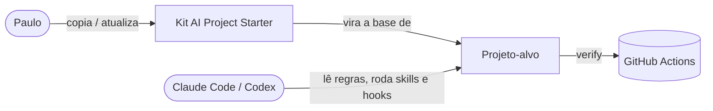

# Architecture Context

> Lido sob demanda. Fonte da verdade sobre **como** o kit é construído.
> Regra: só registre aqui o que é verdade no repositório (ou foi aprovado). Decisões e o porquê → ADRs em `decisions/`.

| Campo | Valor |
|---|---|
| Última atualização | 2026-10-12 |
| Estilo arquitetural | Template de repositório (Markdown + scripts Node sem dependências), distribuído por cópia/Copier |

## 1. Visão de contexto (C4 nível 1)



## 2. Componentes (C4 nível 2)
| Componente | Responsabilidade | Tecnologia | Pasta (dentro de `kit/`) |
|---|---|---|---|
| Regras | Constituição e entrada por agente | Markdown | `AGENTS.md`, `CLAUDE.md` |
| Contexto | Memória e documentação do projeto-alvo | Markdown | `context/` |
| Skills | Workflows (`/kickoff`, `/spec`...) | Agent Skills (SKILL.md) | `.claude/skills/` |
| Travas | Permissões e hooks | JSON + Node | `.claude/settings.json`, `.claude/hooks/` (planejado) |
| Subagentes | Revisor e verificador independentes | Markdown | `.claude/agents/` (planejado) |
| Scripts | `verify`, lint do contexto (prontos); sync de skills (planejado) | Node ≥ 20, sem dependências | `scripts/`, config em `kit.config.json` |
| Guia | Como usar e por quê | Markdown | `starter-guide/` |

## 3. Stack (versões fixadas)
| Camada | Tecnologia | Versão | Por quê (link ADR) |
|---|---|---|---|
| Documentos | Markdown (GFM) + Mermaid | — | ADR-0001 |
| Scripts e hooks | Node.js, módulos `.mjs`, só stdlib | ≥ 20 (local: 22.19) | ADR-0002 |
| Distribuição | Cópia manual hoje; Copier proposto | Copier via `uv tool` | [NEEDS CLARIFICATION: confirmar na spec 08] |
| Testes dos scripts | `node:test` (embutido) | Node ≥ 20 | ADR-0002 |
| CI | GitHub Actions | — | spec 10 |

## 4. Estrutura de pastas
```
/                  → projeto de melhoria (regras e contexto DESTE trabalho)
/context           → overview, tracker, specs, ADRs, pesquisa deste trabalho
/kit               → PRODUTO: o template que vai para cada projeto novo
/kit/.claude       → settings, skills, (hooks, agents)
/kit/context       → templates de contexto do projeto-alvo
/kit/scripts       → verify.mjs, lint-context.mjs, lib/ (sync-skills planejado)
/kit/kit.config.json → passos do verify e orçamento de linhas do projeto-alvo
/kit.config.json   → passos do verify DESTE repositório (testes + lint do template)
/kit/starter-guide → guia de uso
/tests             → testes `node:test` dos scripts do kit; projetos-alvo temporários criados por `helpers.mjs`
```
**Regra:** novos arquivos seguem esta estrutura. Pasta nova = atualizar esta seção.
O kit original continua intocado em `../ai-project-starter/` como backup da v1.

## 5. Fluxos principais
1. Projeto novo: copiar `kit/` → `git init` → `/kickoff` → revisão humana → commit.
2. Tarefa: `/spec` → aprovação → `/implement` → hook `PostToolUse` checa cada edição → `verify` → hook `Stop` bloqueia se vermelho → `/review` (subagente) → `/session-end`.
3. Atualização do kit: nova versão em `kit/` → `copier update` no projeto-alvo → conflitos resolvidos pelo humano.

## 6. Modelo de dados
| Entidade | Campos principais | Relações |
|---|---|---|
| Spec | número, status, nível, ACs (status + evidência), tarefas | ligada a ADRs e ao tracker |
| ADR | número, status, data, decisão | pode substituir outro ADR |
| Lição | data, erro, causa, regra, ocorrências | pode virar regra no AGENTS.md |

## 7. Integrações externas
| Serviço | Para quê | Autenticação | Limites/custos | Docs |
|---|---|---|---|---|
| Claude Code | Agente principal; skills, hooks, subagentes | conta do usuário | — | https://code.claude.com/docs |
| Codex | Agente suportado; lê AGENTS.md e `.agents/skills` | conta do usuário | — | https://developers.openai.com/codex |
| Cursor | Agente suportado; lê AGENTS.md e `.cursor/rules` | conta do usuário | — | https://docs.cursor.com |
| GitHub Actions | CI do projeto-alvo | repo GitHub | gratuito para repos públicos | https://docs.github.com/actions |

## 8. Requisitos não-funcionais
- **Performance:** hooks `PostToolUse` < 5 s por edição; `verify` completo é responsabilidade do projeto-alvo.
- **Segurança:** nenhuma afirmação de bloqueio que não seja verdadeira; travas documentadas com seus limites.
- **Portabilidade:** Windows (Git Bash), macOS, Linux; sem dependência de `pwsh`.
- **Custo de contexto:** arquivos sempre carregados ≤ 400 linhas somados.
- **Custo:** zero.

## 9. Segredos e configuração
- O kit não usa segredos. Os templates ensinam `.env.example` no projeto-alvo.

## 10. Comandos
> A IA usa esta seção para rodar e verificar o projeto. Mantenha exata.
| Ação | Comando |
|---|---|
| Instalar | — (sem dependências) |
| Rodar em dev | — |
| Testes | `node --test "tests/*.test.mjs"` (Node 22 não aceita pasta; use o glob) |
| Lint do contexto | `node kit/scripts/lint-context.mjs` (este repo) / `--root kit` (o template) |
| Verify | `node kit/scripts/verify.mjs` — roda os passos de `kit.config.json` da raiz (~60 s) |
| Build | — |

## 11. Ambientes e deploy
| Ambiente | URL/local | Como faz deploy |
|---|---|---|
| Dev | `Desktop\ai-project-starter\ai-project-starter-v2` | — |
| "Prod" | repositório público no GitHub (MIT), nome a definir | tag de versão + `copier update` nos projetos-alvo |

## 12. Zonas protegidas
- `../ai-project-starter/` (kit v1 original): só leitura.
- `context/decisions/` aceitos: nunca apagar, só `Superseded`.
